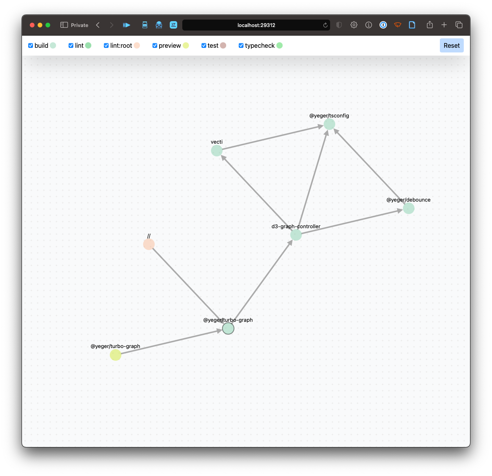

# @yeger/turbo-graph

[](https://npmjs.com/package/@yeger/turbo-graph)

> Interactive visualization and execution of Turborepo task graphs.



## Installation

```bash
pnpm add -D @yeger/turbo-graph
```

## Usage

The visualization can be opened by running this package's `turbo-graph` command.
For simple usage, create a script in your root `package.json`.

```json
{
  "scripts": {
    "graph": "turbo-graph"
  }
}
```

Nodes represent your packages.
Each package can have multiple nodes, each color defining the corresponding task.

### CLI

Optionally, the CLI command can be followed by a list of tasks names that are loaded at startup.
E.g., `turbo-graph build test` will load `build` and `test` tasks.
Like the `--filter` option listed below, this only applies if the `--open` open option is used.

- `-f, --filter <filter>`: Filter nodes by a Turborepo filter (e.g., `my-lib...`).
- `-o, --open`: Open the visualizer in the default browser.
- `-p, --port <port>`: Port of the visualizer. (default: 29312)
- `-h, --help`: Display help message

### Authentication

On startup, the CLI generates and prints a random auth code.
Open the UI with this code via the `code` query parameter, or enter it on the prompt shown by the UI.
The UI stores the code in `localStorage` (scoped to its origin, including the port), removes it from the URL, and sends it to the API in an `Authorization` header.
No cookies are used, as browsers would send them to every other server on `localhost`. The API rejects all requests without a valid code.
With `--open`, the code is added to the opened URL automatically.

### Controls

By double-clicking a task node, its package is used as the filter.

## License

[MIT](https://github.com/DerYeger/yeger/blob/main/packages/turbo-graph/LICENSE) - Copyright &copy; Jan Müller
